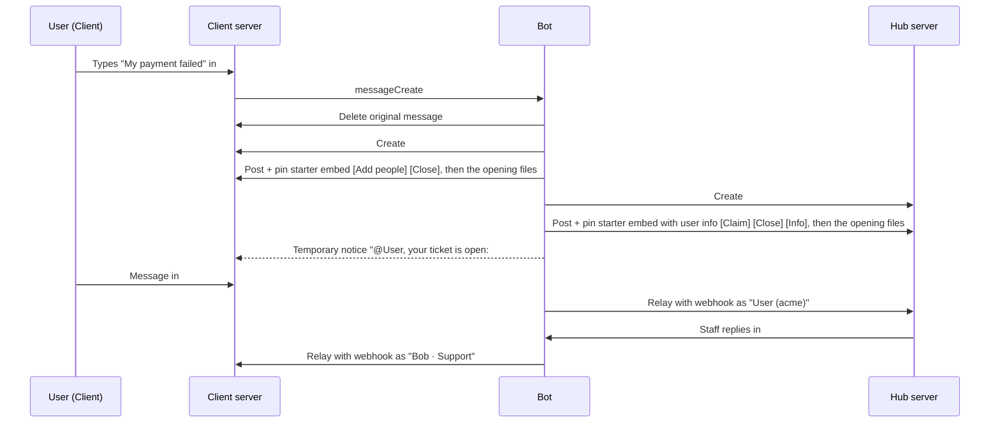

# Cross-Server Ticket Bridge: Design Specification

This document is the design specification for developers. For the code structure, refer to [architecture.md](architecture.md).

The bot changes a message in a community server into a private ticket. Then the bot copies the ticket into one central staff server. The support team answers from the central server. The user does not leave the community server.

---

## 1. Terminology

| Term | Description |
|---|---|
| **Hub server** | The one central server where the support team works. There is only one hub server. |
| **Client server** | A community server where users open tickets. There can be any number of client servers. |
| **Intake channel** | The channel in a client server where users type a message to open a ticket. |
| **Ticket** | Two linked ticket channels: one in the client server and one in the hub server. Messages go in the two directions. |
| **Client ticket channel** | The ticket channel in the client server. |
| **Hub ticket channel** | The ticket channel in the hub server. |
| **Opener** | The user who opened the ticket. |
| **Participant** | A user who is not staff and who the opener added to the ticket. |
| **Client staff role** | A role in a client server. Members with this role can see, moderate, and reply in the tickets of that client server. |
| **Client staff** | Members of a client server who have a client staff role or the Manage Server permission. |
| **Hub staff role** | An optional role in the hub server. It limits hub staff to the members with this role. |
| **Hub staff** | Hub server admins and members with a hub staff role. If no hub staff role is set, all members who can see the hub ticket channel. |
| **Tag** | A short code for each client server, for example `acme`. The bot uses the tag in hub ticket channel names: `acme-0042`. |
| **Hub log channel** | The channel in the hub server that receives alerts and link requests. |
| **Transcript channel** | The channel in the hub server that receives the full transcripts. |
| **Client log channel** | An optional channel in a client server that receives open and close notices and transcripts. |

The terms above are internal names. In text that users see, the bot only uses "support team" and "ticket".

---

## 2. Flow from start to end



---

## 3. Setup and link

### 3.1 Hub server (one time)

The environment of the bot sets the hub server (`HUB_GUILD_ID`). A command cannot set it. Thus, a person who invites the bot cannot make their server the hub server.

Hub admins then use these commands:

- `/hub setup`: Selects or creates the hub log channel (`#ticket-log`) and the transcript channel (`#ticket-transcripts`).
- `/hub config ...`: Sets the hub settings (refer to section 9).
- `/hub staff-roles ...`: Sets the optional hub staff roles.

### 3.2 Client server (one time for each community server)

1. A server admin invites the bot with the permissions in section 11.
2. The admin runs `/setup`. The command has only optional options. For each item, the bot uses the option, the saved value, or a new item:
   - A **ticket category** (`category`, new: `Tickets`). The bot hides the category from @everyone.
   - An **intake channel** (`intake-channel`, new: `#open-a-ticket`). The bot posts and pins an instruction embed in this channel.
   - One **client staff role** (`staff-role`, optional). More roles: `/config staff-roles add`.
   - A **client log channel** (`log-channel`, optional).
3. The bot examines its permissions on each of these items. The bot shows a list of the missing permissions.
4. The status of the client server changes to `pending`. The bot posts a link request in the hub log channel. If the hub log channel is not set, the bot tells the admin to run `/setup` again later.
   > **New server wants to connect**
   > Server: Acme Gaming (`123…`) · Members: 4,210 · Owner: @Owner
   > [Approve] [Reject]
5. A hub admin clicks **Approve**. One modal opens with two fields: a **tag** text field and a **hub category** select menu. The bot suggests a tag from the server name. Many client servers can use the same hub category. Each client server can also have its own hub category.
6. The status of the client server changes to `active`. The intake embed changes to the live instructions. The bot posts a notice in the client log channel.

`/clients approve <server> <tag> <category>` does the same as step 5. Approval works only for `pending` servers. **Reject** and `/clients reject` set the status to `unlinked`. An `unlinked` server must run `/setup` again. Then the status changes to `pending` and the bot sends a new link request.

Client server statuses:

| Status | Intake behavior |
|---|---|
| `pending` | The bot deletes messages. A temporary notice shows "Tickets are not open yet." The intake embed says that the server is still being connected. |
| `active` | Normal operation. |
| `paused` | The hub sets this status (`/clients pause`). The bot deletes messages. The notice and the intake embed show the pause message or a default text. Open tickets continue to operate. |
| `unlinked` | The bot left the server, the server removed the bot, the hub rejected the server, or the hub unlinked the server. The bot force-closes all open tickets and makes transcripts. The notice shows "Support is unavailable right now." |

**Servers that are not approved.** A server that the hub does not approve stays `pending`. A possible later option is `AUTO_LEAVE_UNAPPROVED_AFTER=7d`. The code does not have this option.

---

## 4. Open a ticket (intake)

When a message arrives in the intake channel of a client server, the bot does these steps:

1. **Ignore** system messages and messages from bots, webhooks, and the bot itself. The message of any other member opens a ticket. This includes client staff.
2. **Examine the status.** If the client server is not `active`, delete the message. Post the notice for the status (section 3.2).
3. **Lock for each user.** If a ticket for this user is in creation, delete the message. The notice says "your ticket is already being set up."
4. **Validate** the message. If a check fails, delete the message and post a temporary notice. The notice deletes itself after approximately 10 seconds. Normal messages cannot be ephemeral, thus the bot uses a temporary notice. The checks are:
   - The user is not on the blacklist of the client server or on the global blacklist.
   - The user has fewer `open` tickets than `max_open_tickets` (default 1). The notice gives a link to the open ticket.
   - The message text has a minimum of `min_subject_length` characters (default 10).
   - The **cooldown** after the last close is over (`cooldown_seconds`, default 0). The cooldown starts when the ticket closes (start of the grace period). The notice tells when the user can open a new ticket.
5. **Keep the subject and the files.** The subject is the message text (maximum 4,000 characters). The bot downloads the attachments before it deletes the message, because the original files go away with the message. The bot does not download files that are larger than the upload limits of the two servers. Each download stops after 30 seconds.
6. **Delete** the original intake message. This keeps the intake channel clean.
7. **Create the client ticket channel** `ticket-0042-username` in the ticket category (section 5). The name uses the username of the opener.
8. **Create the hub ticket channel** `acme-0042` in the linked hub category of the client server (section 6).
9. **Create one webhook for each ticket channel** on the two sides, and save the webhooks. All relayed messages use these webhooks.
10. **Post the starter messages** on the two sides. Post the files of the opening message in a second message after each starter message. The text is "Files from the opening message:". A file that is too large for a server shows as a link.
11. Post the temporary notice "@User, your ticket is open: #ticket-0042-username".

**If a step fails** (for example, the hub category is missing), the bot rolls back all steps. The bot deletes the channels and the database row that it created. The bot tells the user "we couldn't open a ticket right now. Staff got a notification." The bot sends an alert "Could not open a ticket" with the error to the hub log channel. A ticket that is only partly made never stays.

**Numbers:** Each client server has its own counter (`0001`, `0002`, …). The database also gives each ticket a global ID for internal use.

---

## 5. Client ticket channel

### Permissions (channel overwrites, not synced to the category)

| Who | View | Send | History | Attach/Embed | Manage Messages |
|---|---|---|---|---|---|
| @everyone | ❌ | | | | |
| Opener | ✅ | ✅ | ✅ | ✅ | |
| Participants | ✅ | ✅ | ✅ | ✅ | |
| Client staff roles | ✅ | ✅ | ✅ | ✅ | ✅ |
| Bot | ✅ | ✅ | ✅ | ✅ | ✅ and Manage Channel, Manage Webhooks |

### Starter message (posted and pinned)

```
Ticket #0042
> My payment failed and I was charged twice …
Opened by: @User   Opened: <date and time>   Status: 🟢 Open · Waiting for support
Participants: @Friend            (only if there are participants)
[👥 Add people]  [🔒 Close]
```

The title is `Ticket #0042`. The description is the subject as a quote block. The embed has three inline fields: **Opened by**, **Opened**, and **Status**.

When the ticket is closed, the status changes to "🟠 Closed · Can be reopened until <time>". The embed also shows the reason, and the buttons change to **[🔓 Reopen]**. At the end of the grace period, the status is "⚫ Closed" and the embed has no buttons.

The bot pins the starter message. Then the bot deletes the "Bot pinned a message" system message immediately.

### Add people

A button and the native user picker of Discord give the most simple user experience:

- **👥 Add people** opens an ephemeral panel. The **Add people** `UserSelectMenu` lets the user select a maximum of 10 people at one time. The maximum is also limited by the free participant slots.
- The bot gives a channel overwrite to each selected user. Then the bot posts "@User added @Friend to the ticket." in the client ticket channel and a notice with names in the hub ticket channel.
- The **Remove people** select menu is in the same panel. It shows the current participants.
- The reply tells the user which people the bot added or removed, and why it skipped other people.
- Slash commands also work in the client ticket channel: `/ticket add <user>` and `/ticket remove <user>`.

Rules:

- Only the client ticket channel has these functions. The hub side cannot add or remove people.
- The opener and client staff can add or remove people. Participants can also do this if `participants_can_add` is on (default off).
- The maximum number of participants for each ticket is `max_participants` (default 5).
- A user cannot add bots, themselves, the opener, current participants, client staff, or users on a blacklist. Users who are not members of the client server also cannot be added.
- A user cannot remove the opener.
- If a participant leaves the client server, the bot removes the participant from the ticket.

---

## 6. Hub ticket channel

- The bot creates the hub ticket channel in the linked hub category of the client server. **The channel gets a copy of the category permissions.** Thus, hub admins control access with normal Discord permissions. For example, only the "Acme team" role can see the "Acme" category.
- The bot sets the channel topic to `Acme Gaming · @User (id) · Subject…`.

### Starter message (posted and pinned)

```
Acme Gaming (author line with the server icon)
Ticket #0042
> My payment failed and I was charged twice …
Opener: @User / username   Account created: 3 years ago   Joined server: 2 months ago
Prior tickets: 2 (last closed 5 days ago)   Status: 🟢 Open · Unclaimed
User ID: 123…                    (footer)
[🙋 Claim]  [🔒 Close]  [📄 Info]
```

The author line shows the name and the icon of the client server. It shows them only once. The title is `Ticket #0042`. The description is the subject as a quote block.

The embed has five inline fields: **Opener** (mention and username), **Account created**, **Joined server**, **Prior tickets**, and **Status**. The footer shows `User ID: <id>`.

If the opener left the client server, the **Joined server** field shows "Not in the server anymore".

### Claim a ticket

- **Claim** (button or `/ticket claim`) gives the ticket to the staff member. The bot updates the two starter embeds. The hub embed shows "Claimed by @Bob". The client embed shows "<label> is helping you". The bot also posts the notice "<label> is now helping you." in the client ticket channel.
- The label comes from the staff identity mode (section 7): `Bob`, `Support Team (Moderator)`, or `Support Team`.
- `/ticket unclaim` removes the claim. The client notice is "Your ticket is waiting for the support team again."
- `/ticket transfer <staff>` gives the claim to a different hub staff member.
- Claim commands work only in the hub ticket channel, and only for hub staff.
- A claim gives only information. A claim does not stop other staff.

### Internal notes (hub server only, never relayed)

Staff must often discuss a ticket, and the user must not see this discussion. There are two methods:

- The bot does **not relay** a hub message that starts with the **note prefix** (default `//`). The bot adds the 🔒 reaction to the message. This shows staff that the message stayed internal.
- `/ticket note <text>` posts a "🔒 Internal note" embed with the footer "Only staff can see this."

---

## 7. Message relay (the bridge)

### What the bot relays

| Event | Behavior |
|---|---|
| New message | The webhook of the other ticket channel sends the message. It uses the avatar and name of the author, with a suffix (refer to "Names on relayed messages"). |
| Attachments | The bot uploads the files again. If a file is larger than the upload limit of the target server, the bot posts a link. |
| Edits | The bot edits the relayed message. Webhooks can edit their own messages. |
| Deletes | The bot deletes the relayed message. |
| Replies | Webhooks cannot make real replies. Thus, the bot adds a quote line `> ↪ Replying to **Bob**: first 80 characters… [↗]`. The link goes to the relayed copy of the original message. |
| Stickers | The bot relays the sticker image URL. For animated Lottie stickers, it sends `[sticker: name]`. |
| User mentions | The bot shows them as plain `@DisplayName` text. **The bot never pings across servers.** |
| Role and channel mentions | The bot changes them to `@RoleName` and `#channel-name` text. The IDs are not valid in the other server. |
| @everyone and @here | Never ping. Each relayed message uses `allowed_mentions: { parse: [] }`. |
| Long messages (Nitro, 4,000 characters) | The bot splits them into parts of 2,000 characters or fewer. |
| Embeds | Discord makes link previews again from the relayed text. The bot copies the other embeds of the message (maximum 10). |
| Reactions, pins, threads, system messages | Not relayed. Only normal messages and replies from people are relayed. |
| Messages while the ticket is not `open` | Not relayed. This includes new messages, edits, and deletes in the grace period and after it. |
| Bot system events | Member added or removed, claim, close, reopen, and other events. The bot posts them directly as small embeds on each side. The bot does not relay them. |

### Names on relayed messages

- Client server to hub server: `DisplayName (acme)`. The suffix is the tag of the client server. If the client server has no tag, the suffix is the server name. Client staff show as `DisplayName (acme Staff)`.
- Hub server to client server: the **staff identity mode** (a hub setting) controls the name:

| Mode | Webhook name | Label in notices and in the client starter embed |
|---|---|---|
| `named` (default) | `Bob · Support` | `Bob` |
| `anonymous` | `Support Team`, with the icon of the hub server | `Support Team` |
| `role` | `Support Team · Moderator` (highest role) | `Support Team (Moderator)` |

If a staff member has no role, the `role` mode uses only `Support Team`. `src/relay/identity.ts` makes the webhook names. `src/core/staffLabel.ts` makes the labels.

The bot cleans webhook usernames. Discord rejects the substrings "discord" and "clyde", thus the bot changes them. The maximum length is 80 characters.

### Loop prevention and message order

- Ignore all messages that have a `webhook_id`. Ignore all messages from bots, including this bot. All relayed messages come from the webhooks of the bot. Thus, the bot never relays them back.
- **One queue for each ticket:** the relay jobs of a ticket run one at a time. Thus, messages arrive in the correct order, also during rate limits. Different tickets run in parallel.
- The bot records each relayed message in `message_links` (source to copy). These records make edits, deletes, and replies possible.

### Catch-up after bot downtime

Each ticket keeps the ID of the last relayed message from each side. At startup, the bot gets the messages after that ID in each open ticket channel. The bot relays them in order, before new messages. Each of these messages gets the small line `sent while the bridge was offline`. The maximum is 500 messages for each channel. Thus, normally no message is lost when the bot restarts.

---

## 8. Close, transcripts, reopen

### Who can close a ticket

In the client ticket channel, the opener and client staff can close a ticket. In the hub ticket channel, hub staff can close a ticket. Participants cannot close a ticket.

### Close procedure

1. A user clicks **🔒 Close**. An ephemeral confirmation shows "Close this ticket? It can be reopened for N minutes." It has two buttons: **Close** and **Close with reason**. **Close with reason** opens a modal with a required reason (maximum 500 characters). `/ticket close [reason]` closes with no confirmation.

   Hub staff can also close a ticket at once. On the hub side, the confirmation has a third button, **Close now (no reopen)**. `/ticket close now:True` does the same. There is no grace period and no Reopen button. The bot sends the transcripts and then finalizes the ticket immediately.
2. The ticket status changes to `closing`, and the bot sets `closed_at`. In the client ticket channel, the bot removes the Send Messages permission from the opener and participants.
3. The two sides get the notice "🔒 Ticket closed by X.", the reason, and the time when the bot deletes or archives the channel. In the client server, X is a mention or the staff label (section 7). An automatic close shows "Ticket closed automatically."
4. **Transcripts:** the bot makes HTML files (with `discord-html-transcripts`) immediately:
   - Transcript channel in the hub server: a transcript of the **hub** ticket channel. It has the two sides of the conversation and the internal notes.
   - Client log channel (if set): a transcript of the client ticket channel. It does not include internal notes.
   - DM to the opener: the same client transcript (`dm_transcripts`, default on), with the text "Your ticket in **Server** was closed." The bot ignores DM failures.
5. The two starter messages show **[🔓 Reopen]** during the **grace period** (`grace_minutes`, default 10). The bot does not relay messages in the grace period.
6. At the end of the grace period, the bot deletes the client ticket channel. For the hub ticket channel, `archive_mode` decides:
   - `delete` (default): the bot deletes the channel.
   - `move`: the bot moves the channel to the closed category (`Closed Tickets`) and deletes its webhook. If the move fails, the bot deletes the channel and sends an alert to the hub log channel.

If `grace_minutes` is 0, the scheduler ends the ticket at its next tick (within one minute).

### Reopen

During the grace period, the opener, client staff, or hub staff can reopen the ticket (button or `/ticket reopen`). The bot refuses a reopen by the opener if the opener already has `max_open_tickets` open tickets. Staff can always reopen. The bot gives the permissions back, clears `closed_at`, and the status changes to `open`. The relay then starts again for new messages. The two sides get the notice "🔓 Ticket reopened by X." A new close sends new transcripts.

After the bot deletes the channels, the user must open a new ticket. The hub starter embed shows "Prior tickets: N" for context.

### Auto-close for inactivity (optional, hub setting)

Auto-close applies only to `open` tickets where staff sent the last message. Staff are hub staff and client staff.

- If the opener sends no message for `warn_hours` after the last staff message, the bot pings the opener: "Is this resolved? This ticket will close <time> if there's no reply." The hub side gets a notice.
- If the opener sends no message in the next `close_hours`, the bot closes the ticket with the reason "Inactivity".
- Each message from the opener stops the countdown.

### Forced closes

A forced close has no grace period. The bot makes the transcripts and then ends the ticket immediately.

| Trigger | Result |
|---|---|
| A person deletes one of the two ticket channels manually | The bot closes the ticket. It posts a notice in the other ticket channel, makes a transcript from that channel, and then deletes or archives it. |
| The opener leaves the client server | The bot posts "👋 The user left the server." in the hub ticket channel. The ticket stays open. |
| The bot leaves the client server or the server removes it | The bot sets the client server to `unlinked`. It force-closes all tickets of that client server, with transcripts from the hub side. It sends an alert to the hub log channel. |
| The bot starts and is no longer in a linked client server | Same result as the row above. The bot does this check only if it is in the hub server. |
| The hub unlinks the client server (`/clients unlink`) | Same result as the row above. The intake embed shows "Support is unavailable here right now." |
| A person deletes a hub category | The bot pauses the `active` client servers that use the category and sends an alert to the hub log channel. Open tickets stay open. |
| A person deletes the intake channel or the ticket category of a client server | The bot sends an alert to the hub log channel and to the client log channel. |

---

## 9. Commands

This section is a summary. The full reference with all options and limits is in [admin-guide.md](admin-guide.md).

`default_member_permissions` (Manage Server) hides admin commands from normal users. The bot also does a permission check on the server side. Users in `BOT_OWNER_IDS` always pass this check.

### Client server admin (Manage Server permission)

| Command | Purpose |
|---|---|
| `/setup [category] [intake-channel] [staff-role] [log-channel]` | Sets up the server, then sends a link request. |
| `/config view` | Shows all settings and the link status. |
| `/config intake-channel <channel>` | Moves the intake channel. |
| `/config category <category>` | Sets the ticket category. |
| `/config staff-roles add\|remove <role>`, `/config staff-roles list` | Changes the client staff roles. Also updates open tickets. |
| `/config log-channel [channel]` | Sets the client log channel. No channel turns the log off. |
| `/config intake-message` | Opens a modal to edit the text of the pinned instruction embed. |
| `/config intake-post` | Opens a modal with one text field (maximum 4,000 characters). The bot posts the text as an embed in the intake channel. Mentions do not ping. These posts never open a ticket. |
| `/config limits [max-open-tickets] [min-subject-length] [max-participants] [participants-can-add] [cooldown-seconds]` | Sets the limits. No options shows the limits. |
| `/config dm-transcripts <enabled>` | Turns transcripts by DM on or off. |
| `/config check` | Health check: permissions, missing channels, category capacity, staff roles. |
| `/blacklist add <user> [reason]`, `/blacklist remove <user>`, `/blacklist list` | Blocks a user for this client server only. |

### Hub admin (hub server only, Manage Server permission)

| Command | Purpose |
|---|---|
| `/hub setup [log-channel] [transcript-channel]` | Sets the hub log channel and the transcript channel. |
| `/hub config view` | Shows the hub settings. |
| `/hub config staff-identity <mode>` | Sets the staff identity mode: `named`, `anonymous`, or `role`. |
| `/hub config note-prefix <prefix>` | Sets the note prefix. |
| `/hub config auto-close <warn-hours> <close-hours>` | Turns on auto-close. |
| `/hub config auto-close-off` | Turns off auto-close. |
| `/hub config archive-mode <mode> [closed-category]` | Sets the archive mode: `delete` or `move`. |
| `/hub config grace-period <minutes>` | Sets the grace period. |
| `/hub staff-roles add\|remove <role>`, `/hub staff-roles list` | Changes the hub staff roles. |
| `/clients list` | Shows all client servers with status, tag, category, and number of open tickets. |
| `/clients approve <server> <tag> <category>` | Does the same as the **Approve** button and modal. |
| `/clients reject <server>` | Does the same as the **Reject** button. |
| `/clients set-category <server> <category>` | Sets a different hub category. Applies to new tickets only. |
| `/clients set-tag <server> <tag>` | Sets a different tag. Applies to new tickets only. |
| `/clients pause <server> [message]`, `/clients resume <server>` | Stops intake for a period, then starts it again. |
| `/clients unlink <server>` | Force-closes the tickets of the client server and disconnects it. Asks for confirmation. |
| `/blacklist add <user-id> [reason]`, `/blacklist remove <user-id>`, `/blacklist list` | Blocks a user in all client servers. `user-id` is text, because the user is usually not in the hub server. |

The `server` option has autocomplete. It also accepts a server ID or a tag.

### In a ticket (the bot finds the ticket from the channel)

| Command | Side | Who | Purpose |
|---|---|---|---|
| `/ticket add <user>`, `/ticket remove <user>` | Client only | Opener, client staff, participants if `participants_can_add` is on | Adds or removes participants. |
| `/ticket close [reason] [now]` | Both | Client: opener, client staff. Hub: hub staff. `now` is for hub staff only. | Closes the ticket. With `now`, closes it at once with no reopen. |
| `/ticket reopen` | Both | Client: opener, client staff. Hub: hub staff. | Reopens the ticket during the grace period. |
| `/ticket info` | Both | All members who can see the channel | Shows the ticket details. |
| `/ticket claim`, `/ticket unclaim`, `/ticket transfer <staff>` | Hub only | Hub staff | Changes the claim. |
| `/ticket note <text>` | Hub only | Hub staff | Posts an internal note. The bot does not relay it. |
| `/ticket rename <name>` | Both | Staff of that side | Renames the two channels. The number prefix stays. |

In the hub server, "hub staff" are hub server admins and members with a hub staff role (`/hub staff-roles`). If no hub staff roles are set, a member who can see the hub ticket channel is hub staff.

---

## 10. Data model (SQLite)

The block below shows the tables and columns. `src/db/schema.ts` is the source of truth. All timestamps are Unix milliseconds.

```sql
hub_config (one row, id = 1)
  id, log_channel_id, transcript_channel_id, closed_category_id,
  staff_role_ids JSON, staff_identity TEXT,        -- named | anonymous | role
  note_prefix TEXT, auto_close_warn_hours INT NULL, auto_close_close_hours INT NULL,
  archive_mode TEXT,                               -- delete | move
  grace_minutes INT

client_servers
  guild_id PK, status TEXT,                        -- pending | active | paused | unlinked
  tag TEXT UNIQUE, hub_category_id,
  intake_channel_id, intake_message_id, ticket_category_id, log_channel_id,
  name TEXT NULL,                                  -- last known server name
  staff_role_ids JSON, intake_text TEXT NULL, pause_message TEXT,
  max_open_tickets INT, min_subject_length INT, max_participants INT,
  participants_can_add BOOL, cooldown_seconds INT, dm_transcripts BOOL,
  next_ticket_number INT, link_request_message_id,
  approved_by, approved_at, created_at

category_overflows
  base_category_id, category_id, PRIMARY KEY(base_category_id, category_id)

tickets
  id PK AUTOINCREMENT, client_guild_id FK, number INT, opener_id,
  subject TEXT, status TEXT,                       -- open | closing | closed
  client_channel_id, client_webhook_id, client_webhook_token, client_starter_message_id,
  hub_channel_id,    hub_webhook_id,    hub_webhook_token,    hub_starter_message_id,
  claimed_by NULL, created_at, last_opener_activity_at, last_staff_activity_at,
  auto_close_warned_at NULL, closing_until NULL,
  closed_at NULL, closed_by NULL, close_reason NULL,
  last_relayed_client_message_id, last_relayed_hub_message_id
  UNIQUE(client_guild_id, number)
  INDEX(client_channel_id), INDEX(hub_channel_id), INDEX(opener_id, status)

ticket_participants
  ticket_id FK, user_id, added_by, created_at, PRIMARY KEY(ticket_id, user_id)

message_links
  ticket_id FK, source_side TEXT,                  -- client | hub
  source_message_id, copy_index INT, copy_message_id, author_id, created_at
  PRIMARY KEY(source_message_id, copy_index), INDEX(copy_message_id)

blacklist
  scope TEXT,                                      -- client guild_id or 'global'
  user_id, reason, added_by, created_at, PRIMARY KEY(scope, user_id)
```

A long source message can make more than one copy (one copy for each part of 2,000 characters). Thus, `copy_index` is part of the key of `message_links`.

`category_overflows` keeps the overflow categories that the bot creates when a category is full (section 11).

Webhook tokens are credentials. Thus, the database file must not be readable by all users. The bot finds all channels and webhooks by ID and never by name. Thus, a rename in Discord does not cause a failure.

---

## 11. Discord requirements

**Gateway intents:** `Guilds`, `GuildMessages`, `MessageContent` (privileged), and `GuildMembers` (privileged). The bot uses `GuildMembers` to find members who leave and to show account and join information. Turn on the two privileged intents in the Developer Portal. When the bot is in more than 100 servers, Discord requires verification to keep these intents.

**Bot permissions (invite link):**

- View Channels
- Manage Channels
- Manage Roles (necessary to set channel overwrites)
- Manage Webhooks
- Send Messages
- Embed Links
- Attach Files
- Read Message History
- Manage Messages (to delete intake messages and pin notices)
- Pin Messages (to pin the intake message and the starter messages)
- Add Reactions

The bot can only give permissions that it has. Thus, `/config check` examines the permissions of the bot.

**Limits in the design:**

| Limit | Action |
|---|---|
| 50 channels for each category | When a category is full, the bot creates an overflow category (`Acme Tickets 2`) with the same permissions. This applies on the two sides. |
| 500 channels for each server | This is mostly a problem for the hub server, because it has all open tickets. The bot deletes closed tickets. In `move` mode, archived channels still count. At 450 channels, the bot sends an alert to the hub log channel, a maximum of one time each hour. A forum-thread mode for the hub server is possible later if this becomes a real problem. |
| Webhook rate limits | The queue for each ticket and the rate-limit logic of discord.js. |
| 2,000 characters for each message | The bot splits the message. |
| Upload size limits change with the server boost level | The bot sends a link instead. |

---

## 12. Architecture

- **Stack:** TypeScript, discord.js v14, SQLite (`better-sqlite3`) with Drizzle ORM, `discord-html-transcripts`. One process. Sharding is not necessary below approximately 2,500 servers.
- **Configuration:** `.env` has `DISCORD_TOKEN`, `HUB_GUILD_ID`, `BOT_OWNER_IDS`, `DATABASE_PATH`, and `LOG_LEVEL`. All other settings are in the database. Commands set them.
- **Hosting:** a small VPS or a container with a persistent volume for the SQLite file. Use systemd or Docker to restart the bot automatically.

```
src/
  index.ts              Discord client, intents, event wiring, startup
  config.ts             environment variables
  core/                 module contract, interaction router, custom IDs, command sync,
                        permissions, staff checks, text tools, temporary notices, logger
  db/                   schema, connection, migrations, queries
  setup/                /setup, /config, /hub, /clients, /blacklist, link requests
  tickets/              intake, create, close, reopen, participants, claim, transcripts, scheduler
  relay/                queue for each ticket, message to webhook payload, edits, deletes, replies, catch-up
drizzle/                generated SQL migrations
```

The scheduled work (deletion after the grace period, auto-close) uses **timestamps in the database**. The bot examines them every minute. Thus, a restart does not lose scheduled work.

---

## 13. Build phases

1. **MVP:**
   - Hub server from the environment.
   - Client `/setup` with approve and link.
   - Intake to a ticket on the two sides.
   - Relay of text and attachments in the two directions.
   - Close with deletion.
2. **Core improvements:** add and remove participants, relayed edits, deletes and replies, transcripts, claim, internal notes, blacklist, `/config check`.
3. **Resilience:** catch-up after downtime, forced closes (deleted channels, kicked bot, user left), overflow categories, rollback after a failed creation.
4. **Extras:** auto-close, staff identity modes, archive mode `move`, statistics (`/hub stats`: tickets for each client server, median time to first response).

---

## 14. Decisions

These decisions are final:

| Item | Decision |
|---|---|
| Names | "Hub server" and "client server". |
| Default staff identity | `named`. |
| Client staff can reply in tickets | Yes. The bot relays their messages with the label "(acme Staff)". The label uses the client tag. |
| Stack | TypeScript and discord.js. |
| Hub staff roles | Optional. `/hub staff-roles` sets them. |
| Add and remove participants | Only on the client side. The hub side cannot add or remove people. |
| Claim and internal notes | Only on the hub side. |

These items are still open:

- **Automatic leave:** `AUTO_LEAVE_UNAPPROVED_AFTER` is a possible option. It is not in the code at this time.
- **Statistics:** `/hub stats` (build phase 4) is not in the code at this time.
